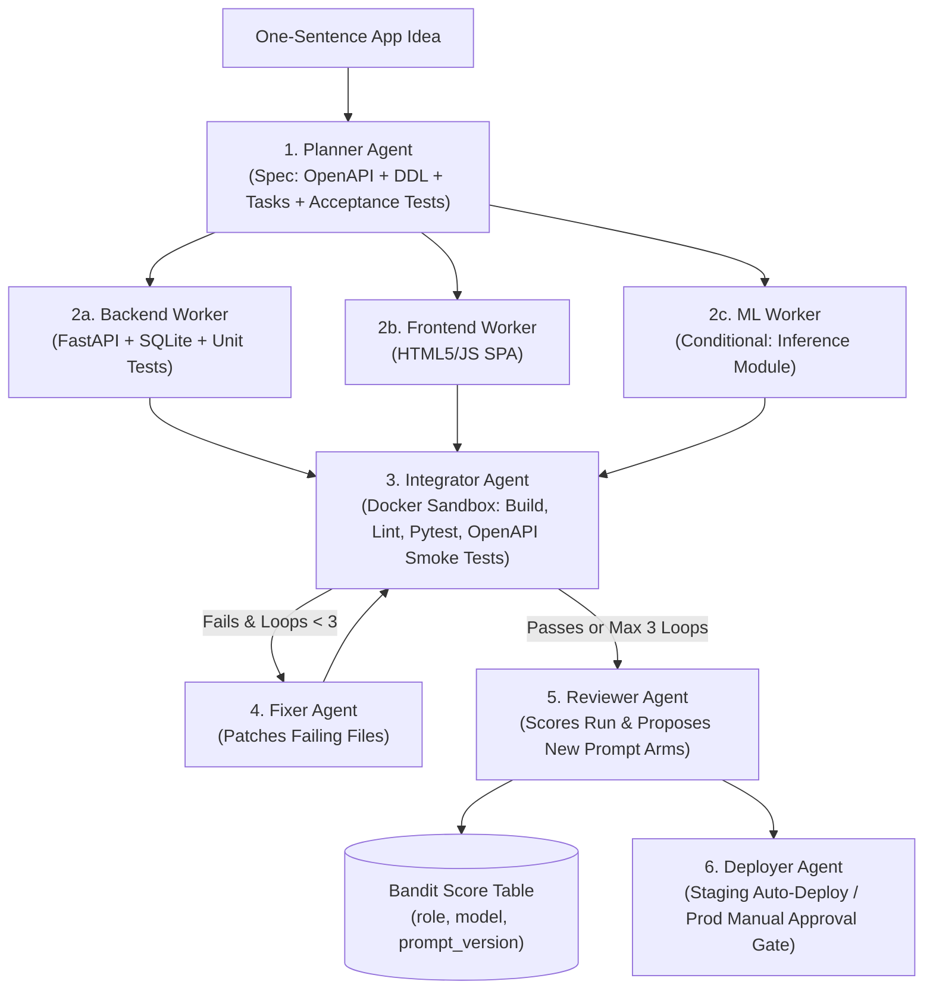

# Zeus (Forge): Multi-LLM Pipeline for Autonomous Web App Synthesis

> **GitHub Repository Description (copy-paste for GitHub About box):**
> `⚡ Forge (Zeus): An autonomous multi-LLM pipeline orchestrated with LangGraph, LiteLLM, and an epsilon-greedy contextual bandit router that turns a single-sentence idea into a tested, sandboxed, and staged full-stack web application.`

---

## Overview

**Forge (Zeus)** takes a single-sentence application prompt (e.g., *"a todo app with auth"*) and autonomously plans, builds, lints, tests, fixes, reviews, and deploys a full-stack web application inside an isolated sandbox, outputting a live staging URL and a complete telemetry report (`runs/<id>/`).

Instead of relying on free-text chat between agents or hardcoding a single monolithic model, Forge enforces **strict Pydantic contracts** at every boundary, routes each specialized role via `config/routing.yaml`, and continuously improves role-to-model-and-prompt assignments using an **epsilon-greedy bandit learning loop**.

---

## Architecture



---

## Hard Engineering Rules Enforced

1. **Zero Hardcoded Models**: Every model assignment, fallback model, temperature, and prompt version lives in [`forge/config/routing.yaml`](forge/config/routing.yaml).
2. **Strict Pydantic Hand-offs**: Every agent input and output is validated via [`forge/schemas.py`](forge/schemas.py) (`Spec`, `Task`, `WorkerOutput`, `Report`, `FixerOutput`, `Score`, `DeployResult`).
3. **Isolated Sandbox Execution**: Generated code is written and executed inside [`DockerSandboxRunner`](forge/sandbox/runner.py) with path-traversal protection and per-command timeouts.
4. **Hard Cost & Iteration Caps**:
   - Maximum **3 Fixer loops** per run.
   - Configurable **per-run USD budget cap** (`BudgetExceededError`) and **per-step timeout** (`StepTimeoutError`) in [`forge/llm.py`](forge/llm.py).
5. **Staging-First Deployment Gate**: Verified builds automatically deploy to staging; production deployments strictly require explicit human approval (`human_approved=True`).
6. **Full Run Provenance**: Every execution persists `spec.json`, `report.json`, `score.json`, `deploy.json`, `integrator.log`, and `llm_calls.json` under `forge/runs/<run_id>/`.

---

## Learning Loop (Bandit Router vs. "Backprop")

Because no differentiable gradients exist across discrete multi-agent LLM calls and compiler/test executions, [`forge/router.py`](forge/router.py) implements an **epsilon-greedy multi-armed bandit**:
- Tracks `(role, model, prompt_version)` arms across **pass rate**, **USD cost**, and **latency**.
- After each run, the **Reviewer Agent** critiques any failures and can propose new prompt refinements (TextGrad/DSPy style), which enter the bandit table as new candidate arms.

---

## Repository Structure

```text
.
├── PROJECT.md
├── README.md
├── pyproject.toml
├── requirements.txt
├── forge/
│   ├── __init__.py
│   ├── schemas.py              # Pydantic models (Spec, Task, Report, Score, DeployResult)
│   ├── llm.py                  # LiteLLM wrapper with cost tracking & budget enforcement
│   ├── router.py               # Epsilon-greedy bandit & score table persistence
│   ├── graph.py                # LangGraph StateGraph orchestration
│   ├── cli.py                  # `forge run "idea"` CLI entrypoint
│   ├── config/
│   │   └── routing.yaml        # Role-to-model routing, budgets, and benchmark configs
│   ├── sandbox/
│   │   └── runner.py           # Docker sandbox runner with timeout & stdout/stderr capture
│   ├── agents/
│   │   ├── planner.py          # Idea -> Spec (OpenAPI, DB schema, tasks, acceptance tests)
│   │   ├── backend.py          # Backend worker (FastAPI + SQLite + pytest)
│   │   ├── frontend.py         # Frontend worker (SPA UI)
│   │   ├── ml.py               # Conditional ML inference worker
│   │   ├── integrator.py       # Build, py_compile lint, pytest, and OpenAPI smoke test runner
│   │   ├── fixer.py            # Automated patch loop (capped at 3 iterations)
│   │   ├── reviewer.py         # Run scoring & prompt evolution critiques
│   │   └── deployer.py         # Staging deployer with manual approval gate for production
│   ├── benchmarks/
│   │   ├── prompts.json        # 20 diverse web app benchmark prompts
│   │   └── run.py              # Baseline single-model vs. Bandit-routed multi-LLM runner
│   └── runs/                   # Per-run artifacts (spec.json, report.json, score.json, logs)
└── tests/
    ├── test_schemas.py
    ├── test_routing_config.py
    ├── test_llm_wrapper.py
    └── test_sandbox_and_pipeline.py
```

---

## Quickstart

### 1. Install Dependencies (Python 3.11+)

```bash
pip install -r requirements.txt
```

### 2. Run the Pipeline via CLI

Run with live LLM providers (configure `GEMINI_API_KEY` or `OPENAI_API_KEY` in environment):

```bash
python -m forge.cli run "a todo app with auth"
```

Or run in deterministic local mock mode (zero API cost, executes real FastAPI + pytest + contract smoke tests in the sandbox):

```bash
python -m forge.cli run "a todo app with auth" --mock
```

### 3. Run the Test Suite

```bash
pytest tests -v
```

### 4. Run the 20-Prompt Benchmark Suite

Compares (a) a single strong model baseline against (b) the bandit-routed multi-LLM chain across all 20 prompts in `forge/benchmarks/prompts.json`:

```bash
python -m forge.benchmarks.run --mock
```
